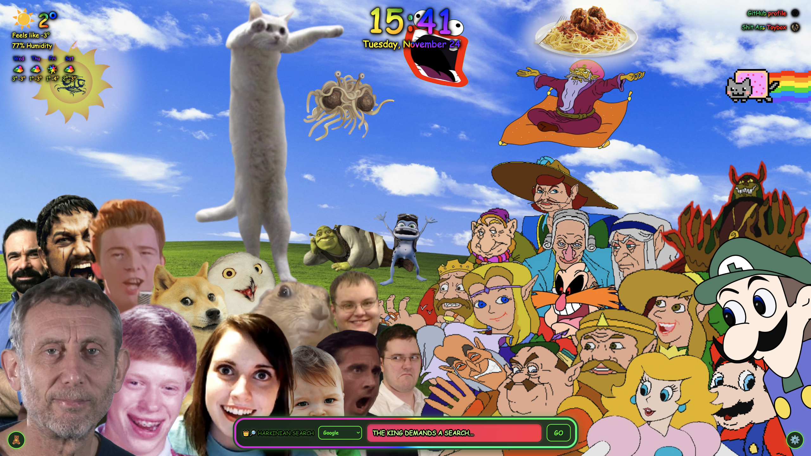
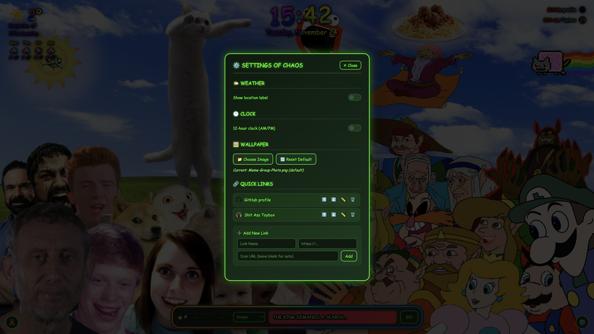
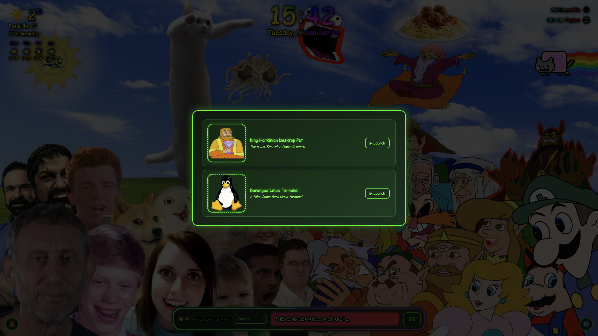

# That1DutchGuy's Meme New Tab

> Inspirational quote: "Mah boi, this new tab is what all true memers strive for!"

---

Always wanted to get that stupid fucking corporate ass boring new tab of yours gone?  
Well now you fucking can! 🤯  
I made a stupid version for both Chromium browsers and Firefox! 🌐🦊

---

### 🌐 Chromium version specs
Current version = 1.1

* 4K Meme Group Photo wallpaper bundled
* Raw Comic Sans MS TTF file bundled
* Unhinged CSS styling, with lotsa unhinged animations
* Weather widget powered by Open-Meteo
* Time and date display
* Quick links stack
* Settings panel where you can upload your own wallpapers, manage quick links, and other shit
* Bundled wallpapers folder with loads of wallpapers made by me (new feature from version 1.1)
* Deranged Toybox panel with more toys coming soon 

### Current toys available

1. King Harkinian Desktop Pet - Browser Edition
2. Deranged Linux Terminal

---

### 🔥🦊 Firefox version specs
Current version = 0.5  

Pretty much the same in aesthetic, except it lacks a lot of settings and the whole Deranged Toybox feature.  
It's basically the Beta version of it.  
Still works, just less features bro. 🤷🏻‍♂️

---

### ⬇️ How to install

> Chromium version:
1. Download and extract the ZIP you downloaded from the Releases tab of this repo ⬇️
2. Go to Manage Extensions in your fucking browser 🌐
3. Enable Developer Mode 🖥️
4. Click the damn "Load unpacked" button and select the Chromium version folder of this crap 🚽
5. Done! Go do whatever you want with my crap! 🤷🏻‍♂️

---

> Firefox version:

1. Go to this Firefox Browser Add-ons page <a href="https://addons.mozilla.org/en-US/firefox/addon/that1dutchguy-s-meme-new-tab/" target="_blank">here</a> in Firefox 🦊
2. SMASH that ADD button ➕️
3. Done! You're good to fucking go 👍🏻

Or

1. Dowload the ZIP from the Releases tab and extract it ⬇️
2. Go to "Manage extensions" and click the Settings icon ⚙️
3. Click "Install Add-on From File" and select the fucking `.xpi` in the downloaded folder 📁
4. Click the goddamn "Add" button and you're good to fucking go 👍🏻

---

### Screenshots gallery (taken in the Chromium version 1.0)

Main page screenshot 🌈  

Settings menu screenshot ⚙️  

Deranged Toybox screenshot 🧸  

--- 

(Note that the Firefox version won't get any updates anymore cuz I don't have the time nor the will to manage two seperate versions all the time 🦊)

---

### FAQ ⁉️

> **Q: Why does the Firefox version have less features than the Chromium one?**  
> **A:** Because I don't use Firefox myself and don't have any motivation for updating it. 🤷🏻‍♂️

> **Q: Why is there a Deranged Linux Terminal?**  
> **A:** Because I use Linux myself. Duh. And because it's funny. 🐧

> **Q: Why the fuck did you port the full King Harkinian Desktop Pet - Browser Edition you made on the Shit Ass Toybox to here?**  
> **A:** Because it's funny. He can now take a shit on your new tab page instead of just the fake browser desktop there. 👑

> **Q: What are the bundled wallpapers?**  
> **A:** Meme Group Photo, Hotel Mario Wallpaper, CD-i Pile Up, King Harkinian's Big Ass Dinner, and Memes On Mountain Lake. 🤳🏻🏨👑🍷⛰️

> **Q: Why isn't the Chromium version on the Chrome Web Store?** 
> **A:** Because Google and their €4.56 registration fee can suck my fucking PINGAS! 🍆

---

### License 🧾

None. Do whatever the fuck you want with this. I don't care. 🤷🏻‍♂️

---